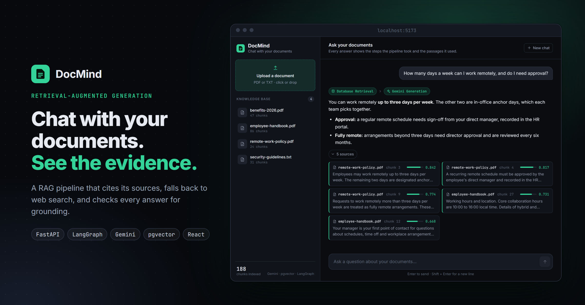
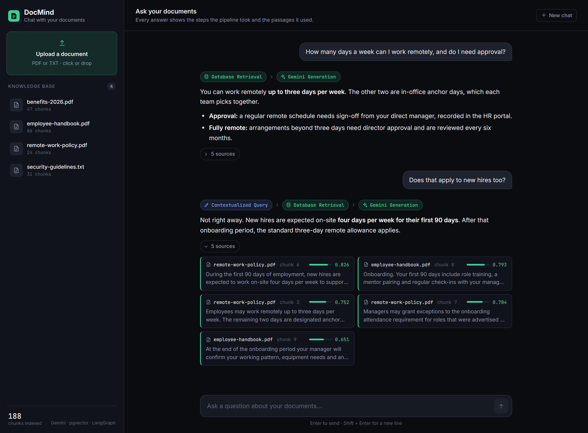
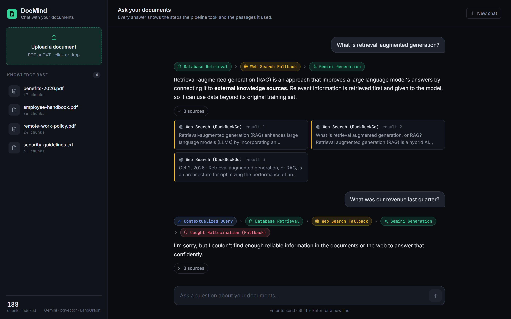
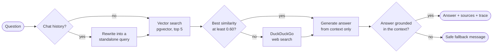

<p align="center">
  
</p>

# DocMind

**Chat with your documents, and see exactly where each answer came from.**

DocMind is a full-stack retrieval-augmented generation (RAG) app. Upload PDFs or text files, ask questions in plain language, and get answers that come with the passages they were built from, the route the question took through the pipeline, and a check that the answer is actually supported by its sources.


## What it does

- **Answers from your documents.** Files are chunked, embedded with Gemini and stored in Postgres with pgvector. Each question retrieves the five most similar chunks and the answer is generated from those alone.
- **Shows its sources.** Every answer lists the chunks it used, with the file name, chunk number and cosine similarity score.
- **Understands follow-ups.** "Does that apply to new hires too?" is rewritten into a standalone search query using the recent conversation before retrieval.
- **Falls back to the web.** If nothing in your documents is similar enough to the question, the pipeline searches DuckDuckGo instead and answers from those results.
- **Catches unsupported answers.** A second model call grades whether the answer is fully backed by the retrieved context. If it is not, the user gets an honest "I couldn't find enough reliable information" instead of a guess.
- **Makes the pipeline visible.** The API returns a trace of the steps that ran, and the UI shows it above each answer.

## Screenshots

A grounded answer, then a follow-up that is contextualized before retrieval:



A question the documents cannot answer goes to web search. An answer that fails the grounding check is replaced with a safe fallback:



<sub>Screenshots show the UI with a sample knowledge base.</sub>

## How it works

The request flow is a [LangGraph](https://langchain-ai.github.io/langgraph/) state machine defined in [`backend/graph.py`](backend/graph.py):



**Ingestion.** Text is extracted (pypdf for PDFs), split into 512-character chunks with a 50-character overlap, embedded with `gemini-embedding-001`, and inserted into a `documents` table with a 3072-dimension vector column. Ingestion pauses after every 50 chunks to stay inside the embedding API's rate limit.

**Retrieval.** The question is embedded with the same model and matched using pgvector's cosine distance operator (`<=>`).

**Routing.** If the best match scores below 0.60, the documents are treated as not containing the answer and the graph takes the web-search branch.

**Generation.** Gemini is prompted to answer using only the supplied context and to say so when the context is not enough.

**Grounding check.** A separate grading prompt returns YES or NO on whether every claim in the answer appears in the context. A NO swaps the answer for the fallback message.

## Tech stack

| Layer | Tools |
| --- | --- |
| API | FastAPI, Pydantic, Uvicorn |
| Orchestration | LangGraph (conditional routing, fallback edges) |
| Models | Google Gemini via `google-genai` (embeddings, generation, query rewriting, grading) |
| Storage | PostgreSQL with pgvector, pooled connections via `psycopg_pool` |
| Web search | DuckDuckGo via `ddgs` |
| Frontend | React 19, TypeScript, Vite |

## Getting started

You need Python 3.11+, Node 20+, Docker (or any Postgres with pgvector) and a [Gemini API key](https://aistudio.google.com/apikey).

**1. Clone and configure**

```bash
git clone https://github.com/stephenmt25/docmind_rag.git
cd docmind_rag
cp .env.example .env        # then set GEMINI_API_KEY
```

**2. Start the database**

```bash
docker compose up -d
```

This runs Postgres with pgvector on port 5432 and applies [`schema.sql`](schema.sql). To use Supabase or another Postgres instead, run `schema.sql` there and point `DATABASE_URL` at it.

**3. Run the API**

```bash
cd backend
python -m venv .venv
source .venv/bin/activate   # Windows: .venv\Scripts\activate
pip install -r requirements.txt
uvicorn main:app --reload --port 8000
```

**4. Run the UI**

```bash
cd frontend
npm install
npm run dev
```

Open <http://localhost:5173>, upload a document and start asking questions. Interactive API docs are at <http://localhost:8000/docs>.

The UI talks to `http://localhost:8000` by default. Set `VITE_API_URL` to point it at a different backend.

## API

| Method | Endpoint | Description |
| --- | --- | --- |
| `GET` | `/` | Health check |
| `POST` | `/api/documents/upload` | Upload and ingest a `.pdf` or `.txt` file (multipart field `file`) |
| `GET` | `/api/documents` | List ingested documents with their chunk counts |
| `DELETE` | `/api/documents/{filename}` | Delete a document and all of its chunks |
| `POST` | `/api/chat` | Ask a question |

```bash
curl -X POST http://localhost:8000/api/chat \
  -H "Content-Type: application/json" \
  -d '{"question": "What is the refund policy?", "chat_history": []}'
```

```jsonc
{
  "question": "What is the refund policy?",
  "answer": "...",
  "sources": [
    { "filename": "policy.pdf", "chunk_index": 12, "content": "...", "similarity": 0.81 }
  ],
  "trace": ["Database Retrieval", "Gemini Generation"]
}
```

`chat_history` is a list of `{ "role": "user" | "assistant", "content": "..." }` messages. The UI sends the last four.

## Project structure

```text
backend/
  main.py          FastAPI app and HTTP endpoints
  graph.py         LangGraph workflow: nodes, routing and the grounding edge
  services.py      Chunking, embedding, retrieval, generation and grading
  database.py      Connection pool and document queries
  models.py        Pydantic request and response models
frontend/src/
  App.tsx          State and API calls
  components/      Sidebar, ChatPanel, MessageItem (trace and sources), icons
  api.ts           Typed API client
schema.sql         Database schema (pgvector)
docker-compose.yml Local Postgres with pgvector
ingest.py          CLI: ingest a file without the API
query.py           CLI: ask questions in the terminal
list_models.py     CLI: list the Gemini models your key can use
```

The CLI scripts run from the repo root with the backend virtualenv active, for example `python ingest.py path/to/file.pdf`.

## Configuration

| Setting | Where | Default |
| --- | --- | --- |
| `GEMINI_API_KEY`, `DATABASE_URL` | `.env` in the repo root | see [`.env.example`](.env.example) |
| Similarity threshold, top-k, web results | constants at the top of `backend/graph.py` | 0.60, 5, 3 |
| Chunk size and overlap | `chunk_text` in `backend/services.py` | 512, 50 |
| Model names | `backend/services.py` | `gemini-embedding-001`, `gemini-3-flash-preview`, `gemini-2.5-flash` |

## Troubleshooting

- **Database connection times out on Windows.** Use `127.0.0.1` rather than `localhost` in `DATABASE_URL`. Docker publishes the port on IPv4 only, and `localhost` can resolve to IPv6 first.
- **Uploads are slow.** Each chunk is one embedding call, and ingestion waits 35 seconds after every 50 chunks to respect rate limits. Large PDFs take a few minutes.
- **Model not found.** Preview model names change. Run `python list_models.py` to see what your key can access and update `backend/services.py`.

## Limitations and next steps

This is a learning project, and a few things are deliberately simple:

- No authentication, and one shared knowledge base for all users.
- Similarity search is an exact scan. That is fine for a few thousand chunks; beyond that it needs an approximate index, which means smaller embeddings or a `halfvec` index because pgvector's indexes stop at 2000 dimensions.
- Ingestion runs inside the upload request. A background job with progress reporting would suit large files better.
- Answers arrive in one piece rather than streaming.
- On follow-ups, the rewritten search query is also what the model is asked to answer. Keeping the user's original wording for generation would improve those answers.
- There is no automated test suite yet.
